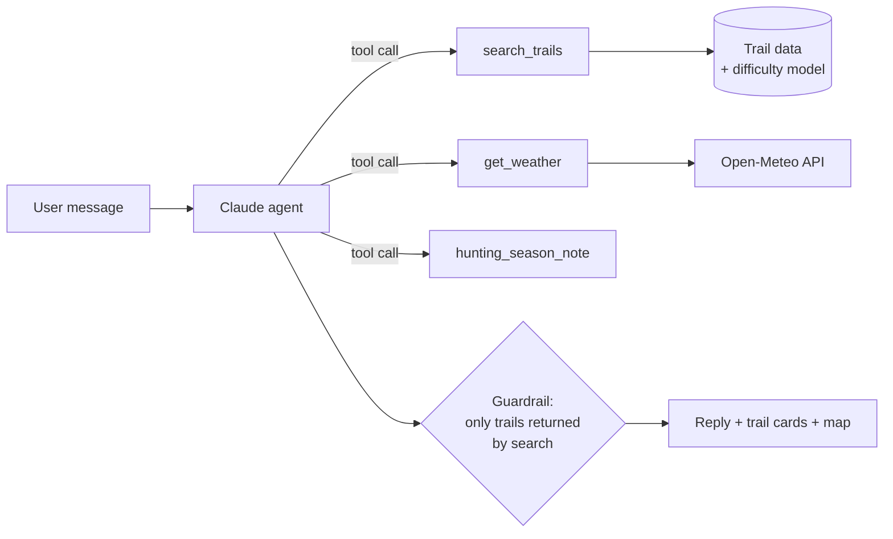

# HikingPSU 

**An AI hiking guide for Penn State and State College, built around difficulty ratings you can trust.**

Tell it *"Saturday afternoon, two of us, no car, about 3 hours, we'd like a view"* and it suggests real trails around Happy Valley. Each suggestion comes with a five-level difficulty rating, the reasons behind that rating, a time estimate, and how to get there without a car.

<!-- Add a screenshot or GIF of the app here:  -->

---

## Why we built this

Central Pennsylvania has hundreds of miles of trails within half an hour of campus. Even so, many students never hike them. When we talked to members of a Penn State hiking club, three problems kept coming up:

- **Difficulty labels are hard to trust.** Mainstream apps use three levels, and users assign them by hand. A short climb up a rocky Pennsylvania ridge and a flat walk around a lake can both end up as "moderate". Experienced hikers told us five levels would be much friendlier to beginners.
- **Many students don't have a car.** Most trail guides assume you can drive to the trailhead.
- **Local knowledge is scattered.** Hunting season, rocky terrain, weak cell signal and parking are things locals know, and most apps don't tell you.

HikingPSU addresses all three, and it is scoped to one region so the information can actually be accurate.

## What it does

- **🗣️ Plan in plain English.** Describe your group, time, transport and mood. The agent turns that into a structured search.
- **📊 Five explainable difficulty levels.** Every level comes with a reason, for example *"L3 · 4 mi, 600 ft of climbing, bumped one level for rocky footing and stream crossings."*
- **🚌 Car-free first.** Each trail is tagged with bus, walking, biking or driving access. Say "no car" and only reachable trails are returned.
- **🌤️ Context-aware.** Checks the forecast and sunset time, and reminds you to wear blaze orange during hunting season on state-forest trails.
- **🗺️ Map view.** Every trail appears on the map, colored by difficulty. Recommended trails are highlighted.
- **Official trail library.** Search manager-published routes, overlay original GIS lines, compare your location, and open official PDF/offline maps at the publisher.
- **⭐ Sorted for you.** For signed-in hikers, the Around Happy Valley list puts the trails that fit them first, ranked by their transport, interests, saved trails and hike log. Ranking is a deterministic score, not the AI: a trail only ranks if you can reach it and it is at most one level above your comfort level, and each ranked card says why it fits. Your comfort level and pace adjust as you log hikes.
- **🛡️ No made-up trails.** The AI can recommend only trails that come back from the database search. Anything else is removed before it reaches you.

## Device-aware interface

The interface adapts automatically to the available viewport and input capabilities,
including changes while resizing a window or rotating a device:

- **960px and wider:** chat, map and trail cards are available together. The trail
  list scrolls only inside the area below the map and is clipped at that area's
  boundary. Official route details and resources appear once in the left sidebar;
  the right pane contains the map. Card selection also works with Enter or Space.
- **Below 960px:** bottom navigation switches between Plan, Trails, Map and Library.
  Recommendations have a shortcut to the results. Selecting a trail opens the
  map, and Trail details returns to the selected card.
- **Touch input:** map pins and zoom buttons have larger hit areas. The mobile
  composer follows the visual viewport when the keyboard opens; safe-area padding
  accommodates device cutouts and the home indicator.
- Conversations, drafts, recommendations and selected trails stay in memory
  across view and layout changes. A full reload starts a fresh anonymous session.
- Reduced-motion preferences disable map and scroll animations.

Layout uses CSS media queries and `matchMedia`, rather than browser-name or
user-agent checks. Hidden map panels retain their map instance and refresh its
size with `ResizeObserver` when shown again.

## Device location

The Logo and Explore button return to the planner from the library, profile,
official routes and expanded map. Chats and drafts are preserved; late search
responses cannot reopen the previous map selection. The compact header reserves
the same avatar/name/action space for Guest, signed-in, loading and error states;
long names are truncated and the guest avatar uses the supplied default image.
The shared header preserves the sky theme, decorative trees and walking hiker,
with 20px padding above and below its content instead of a fixed height.

Map information is placed beside the map on desktops/tablets, with a compact
toolbar above the map on narrow phones. Expand in the map's top-right corner
opens a viewport-filling preview of the same map instance. Back or Escape exits;
keyboard focus stays inside the preview and background controls are inactive.
The development-only `/tests/profile-layout.html` fixture checks synthetic
Guest/short/long/loading/error profiles without an actual sign-in.

Choose **Use my location** in the map controls to request browser permission. The app
asks for a fresh, high-accuracy fix first, then retries once at standard accuracy
if it is unavailable or times out. The browser and operating system choose GPS,
Wi-Fi, cellular or another available location provider; websites cannot select a
particular radio or guarantee that GPS was used. See the [Geolocation API](https://developer.mozilla.org/en-US/docs/Web/API/Geolocation_API).

- A blue point shows the reported location; the blue circle shows the reported
  accuracy radius. Approximate results are displayed with their actual accuracy.
- This requests a **one-time fix** by default. Official route references also offer
  **Follow my position** for explicitly enabled foreground updates. Use **Update my location**
  to request another fix, **Cancel** to stop a pending request, **Clear location**
  to remove it from the page, or **Show trails** to return to the trail map.
- Coordinates stay in page memory and are not sent to our API, AI agent or
  browser storage. Viewing the location on the map loads OpenStreetMap tiles for
  that area. The browser/OS location provider follows its own privacy policy.
- Production needs **HTTPS**; localhost is supported for development. Ordinary
  HTTP on a LAN IP is insufficient for phone testing. Browser and device Location
  Services must be enabled. Embedded pages also need a policy allowing geolocation.
- A denial is respected; the app explains how to change the site's permission
  and continues to work without location. Clearing the marker does not revoke
  the browser permission, which is controlled in the browser's site settings.

Run the location state-machine tests with `npm test --prefix frontend`. For local
UI checks, open `/tests/geolocation.html?scenario=success` on the Vite dev server.
The fixture is visibly labelled **SIMULATED LOCATION** and uses public State College
test coordinates without requesting actual device location. Other scenarios:
`fallback`, `denied`, `timeout`, `unavailable`, `pending` (for cancellation), and
`outside` (a valid location beyond the local trail browsing bounds).
It is not an entry point in the production build. Real GPS/provider accuracy and
OS permission prompts still need physical-device testing.

## How it works

### Official trail library and mapped-route reference

Open **Official library** in the desktop header or **Library** in the phone's
bottom navigation. Search areas, activities and PDF/offline map resources, then
load a manager-listed route onto the OpenStreetMap basemap.
The AI has an official-resource lookup tool; offline demo mode also recognizes
named-area PDF/map requests and returns clickable original publisher links.

The initial source index covers Whipple Dam, Greenwood Furnace, Black Moshannon,
Rothrock State Forest and Mount Nittany. The first three have on-demand DCNR GIS
overlays. Rothrock and Mount Nittany currently have original manager links only;
the app does not infer lines from trailhead pins, wayfinding coordinates or PDFs.
This is a regional pilot, not a worldwide trail search service.

`backend/data/official_sources.json` stores titles, manager identity, coverage,
activity metadata, checked dates and official URLs. **No PDF, GPX or route data
files are hosted.** GIS geometry is read from the fixed public DCNR endpoint
on demand, size/coordinate checked, returned with `Cache-Control: no-store`, and
discarded from server memory after the response. The browser holds an active
overlay in memory only. Upstream failures leave the original map links usable.

Routes are grouped before checking public visibility, ownership and activity;
every included source segment must explicitly permit the selected activity.
Cycling includes ordinary bicycles/mountain bikes where permitted, not e-bikes.
These checks do not establish current opening status: source data may lag closures.
The interface links to manager notices and labels the GIS as a planning reference,
consistent with the [DCNR source metadata](https://www.gis.dcnr.state.pa.us/agsprod/rest/services/Parks/StateParksTrailsSimplifiedPortal/MapServer/0).

**Use my location** shows a one-time fix. **Follow my position** explicitly enables
foreground live updates; Stop, Clear, changing routes, leaving the mobile map,
opening the library, hiding the page and unmounting stop the watch. Position is
never sent to our API, AI or database. The map provider receives tile requests for
the area displayed. Location permissions and device services are still required.

`frontend/src/trailGeometry.js` is independent of React, Leaflet and device APIs.
It matches positions to the actual source lines and orders only endpoint-connected,
non-branching geometry. Disconnected/branched data is overlay-only: no straight
connectors or shortcuts are invented. Reference segment names and distances are
not official junction/turn instructions. Poor accuracy (>60 m), uncertain,
off-route or stale (>45 s) positions suppress along-route progress; a loop start
is never an arrival signal. Reference direction can be reversed. A future native
app can reuse this logic and the HTTP/source contracts, with its own location and
map integrations; background GPS and full turn-by-turn routing remain separate work.

Tests: run `npm test --prefix frontend` and, from `backend`,
`.venv/Scripts/python.exe -m pytest -q`. The dev-only location
fixture also supports `?scenario=on-route` using a public Whipple Lake test point.
No real device location is requested by the fixture. Actual outdoor GPS and
background behavior still require physical-device testing.

The Vite dev proxy normally targets port 8000. Set `HIKINGPSU_DEV_API` before
starting Vite to test against another backend port; production uses `VITE_API_BASE`.



Each part has one job:

| Layer | Responsible for | Not responsible for |
|---|---|---|
| **LLM (Claude)** | Understanding the request, choosing which tools to call, explaining results | Knowing trails, judging difficulty |
| **Difficulty model** | Assigning a 1–5 level from measurable trail attributes | Language |
| **Trail data** | Facts: distance, climbing, terrain, access, coordinates | Ranking |
| **Guardrail** | Dropping any recommendation that wasn't returned by a search | — |

This split is deliberate. Hiking has real safety consequences. A fluent model that invents a trail, or calls a very hard ridge "easy", is worse than having no tool at all. Facts come from data and rules, and the model only handles language.

If the live AI is unavailable (no network, invalid key, model error), the backend falls back to offline keyword matching, so the app still responds.

## The difficulty model

```
effort  = distance (mi) + elevation gain (ft) / 500        ← "equivalent miles"

L1 Starter    effort < 3.0
L2 Easy       effort < 5.5
L3 Moderate   effort < 9.0
L4 Hard       effort < 14
L5 Very Hard  effort ≥ 14

+1 level  if terrain score ≥ 4   (rocky + 2·scramble + water crossings + navigation)
+1 level  if ≤ 2.5 mi with ≥ 600 ft of climbing and it would otherwise be L1
```

Central PA trails are known for rocky footing, and that is why terrain can push a trail up a level. All thresholds live in one `CALIBRATION` dict in `backend/app/difficulty.py`. `backend/scripts/calibrate.py` compares the model's levels with ratings from experienced local hikers and reports how often they agree.

Current ratings for the seed trails:

| Trail | mi | ft gain | Level | Why |
|---|---|---|---|---|
| Arboretum & Hartley Wood Loop | 1.2 | 60 | L1 Starter | 1.2 mi loop; 60 ft of climbing |
| Millbrook Marsh Boardwalk | 1.5 | 30 | L1 Starter | 1.5 mi loop; 30 ft of climbing |
| Walnut Springs & Thompson Woods | 2.5 | 200 | L1 Starter | 2.5 mi loop; 200 ft of climbing |
| Mount Nittany – Mike Lynch Overlook | 2.3 | 650 | L2 Easy | rocky in places; short but steep |
| Musser Gap Trail | 3.6 | 700 | L2 Easy | 3.6 mi out-and-back; 700 ft of climbing |
| Shingletown Gap – Lower Trail | 4.0 | 600 | L3 Moderate | bumped for rocky footing, stream crossings |
| Indian Steps – Tussey Mountain | 2.4 | 900 | L3 Moderate | bumped for rocky footing, hands-on sections |
| Mount Nittany – Full Loop | 5.5 | 1100 | L4 Hard | bumped for rocky footing, easy to lose the trail |
| Shingletown Gap – Ridge Loop | 7.5 | 1500 | L5 Very Hard | rocky, hands-on, navigation, stream crossings |

## Getting started

**Requirements:** Python 3.11+, Node 18+, and an [Anthropic API key](https://console.anthropic.com/). You can skip the key and run offline with `DEMO_MODE=1`.

```bash
git clone https://github.com/Zihan64/HikingPSU.git
cd HikingPSU
```

### Windows (PowerShell)

Initial setup (Python 3.11+ and Node.js LTS):

```powershell
python -m venv backend/.venv
& backend/.venv/Scripts/python.exe -m pip install -r backend/requirements.txt
npm ci --prefix frontend
```

Start both services in offline demo mode, without an API key:

```powershell
powershell -ExecutionPolicy Bypass -File scripts/start-demo.ps1
```

Open http://127.0.0.1:5173. Ctrl+C stops the demo. The launcher also supports a portable
Node.js distribution at `.tools/node-*-win-x64/`; `.tools/` and the Python environment
are local files excluded from Git. Backend logs are in `.tools/demo-backend*.log`.
Offline recommendations match transport, difficulty and feature keywords and preserve transport
preferences in follow-ups. They do not evaluate dates, time budgets, weather or hunting season.
The map tiles still need internet access.

For real AI mode, copy `backend/.env.example` to `backend/.env`, set a real
`ANTHROPIC_API_KEY` and `DEMO_MODE=0`, then run in separate terminals:

```powershell
# Terminal 1
cd backend
& .venv/Scripts/python.exe -m uvicorn app.main:app --env-file .env --reload

# Terminal 2 (from the project root, with Node.js on PATH)
npm run dev --prefix frontend

# Tests (from the project root)
cd backend
& .venv/Scripts/python.exe -m pytest -q
```

### macOS / Linux

**Backend**

```bash
cd backend
python -m venv .venv && source .venv/bin/activate
pip install -r requirements.txt
cp .env.example .env          # add ANTHROPIC_API_KEY, or set DEMO_MODE=1
uvicorn app.main:app --reload # API docs at http://localhost:8000/docs
pytest                        # runs without a network connection or API key
```

**Frontend** (in a second terminal)

```bash
cd frontend
npm install
npm run dev                   # http://localhost:5173, proxies /api to :8000
```

### Configuration

| Variable | Default | Purpose |
|---|---|---|
| `ANTHROPIC_API_KEY` | — | Claude API key |
| `HIKINGPSU_MODEL` | see `agent.py` | Which Claude model the agent uses |
| `DEMO_MODE` | `0` | `1` = no API calls, offline keyword matching |
| `CHAT_LIMIT_ANON_PER_MIN` / `_PER_DAY` | `3` / `20` | Chat limits per anonymous IP |
| `CHAT_LIMIT_USER_PER_MIN` / `_PER_DAY` | `6` / `60` | Chat limits per signed-in user |
| `CHAT_LIMIT_GLOBAL_PER_DAY` | `1000` | Live AI calls per day across everyone; after that, chat answers offline |
| `CHAT_SIGNING_KEY` | random per start | Signs assistant replies so clients can't forge them. Set it if you run several workers |

`backend/.env` is loaded automatically. Variables already set in the environment take priority.

### Sign-in page

For local login, copy `frontend/.env.example` to the Git-ignored
`frontend/.env.local`, set `VITE_API_BASE` to the configured backend used for
profiles, and restart Vite. Open **http://localhost:5173**, matching the registered
Auth0 callback origin. The public Auth0 settings must be present for sign-in;
without them the account control explains availability when Log in is selected.
Guest, authenticated user and loading state all use the same fixed-width header.

When the three `VITE_AUTH0_*` values are set, signed-out visitors see the sign-in page first (`frontend/src/landing/`). **Sign in** and **Create an account** open Auth0 in a pop-up; **Browse trails without an account** opens the app as a guest for the rest of the browser session. Without those values the app opens directly, as before.

The pop-up needs these settings in Auth0 → Applications → your Single Page Application → Settings. List every origin you use, comma-separated, without a trailing slash:

| Setting | Value |
|---|---|
| Allowed Callback URLs | `http://localhost:5173, https://<your-amplify-domain>` |
| Allowed Logout URLs | same list |
| Allowed Web Origins | same list (the pop-up returns the result to this origin) |

## Deploy

- **Backend → Render** (Web Service): root directory `backend`, build `pip install -r requirements.txt`, start `uvicorn app.main:app --host 0.0.0.0 --port $PORT`. Environment: `ANTHROPIC_API_KEY`, `MONGODB_URI`, `AUTH0_DOMAIN`, `AUTH0_AUDIENCE`. Free instances sleep when idle, so open `/health` a minute before a demo.
- **Frontend → AWS Amplify Hosting**: connect this repo, branch `main`, and tick "monorepo" with app root `frontend` (`amplify.yml` holds the build). Environment variables: `VITE_AUTH0_DOMAIN`, `VITE_AUTH0_CLIENT_ID`, `VITE_AUTH0_AUDIENCE`, `VITE_API_BASE=https://<your-render-service>.onrender.com`, `AMPLIFY_MONOREPO_APP_ROOT=frontend`. Vite bakes these in at build time, so redeploy after changing them. Then add the Amplify URL to the three Auth0 settings above.

## API

| Method | Path | Description |
|---|---|---|
| `GET` | `/health` | Liveness check and trail count |
| `GET` | `/trails?max_level=&car_free=&max_time_min=` | Filtered list of trails with difficulty |
| `GET` | `/trails/{id}` | One trail |
| `GET` | `/official/library?q=&activity=&kind=` | Search curated manager pages and PDF/offline map links |
| `GET` | `/official/trails?area_id=&activity=&q=` | Live manager-listed route names with complete-segment activity checks |
| `GET` | `/official/trails/{area_id}/{route_id}/geometry?activity=` | Validated original manager line geometry, provenance and planning notice; not persisted |
| `POST` | `/chat` | `{ messages: [{role, content}], profile: {has_car} }` → reply, recommended trails, tool log. Send `Authorization: Bearer <token>` to use your saved profile and save the chat (optional `session_id` continues one) |

### User database (MongoDB)

Set `MONGODB_URI`, `AUTH0_DOMAIN` and `AUTH0_AUDIENCE` in `backend/.env` (and the three `VITE_AUTH0_*` values in `frontend/.env.local`, see `frontend/.env.example`). Without them everything above still works; the routes below return 503.

Login is handled by **Auth0**: the browser signs in there and sends `Authorization: Bearer <token>`; the backend verifies it with Auth0's public keys. We never see or store passwords. The Auth0 user id (`auth0|…`, `google-oauth2|…`) is the user's `_id`, and the first authenticated request creates the user's document.
Collections: `users` (account, profile, preferences, saved trails), `hike_logs` (one doc per completed hike), `chat_sessions` (messages embedded).
All `/me` routes need a bearer token and only ever see the caller's own data.

| Method | Path | Description |
|---|---|---|
| `GET` | `/auth/config` | `{ enabled }`: whether login is configured on this server |
| `GET` `PATCH` `DELETE` | `/me` | Profile and preferences (PATCH changes only the fields sent); DELETE erases the account and all its data (profile, sign-up details, saved trails, hike log, chats, reviews), plus the Auth0 login when `AUTH0_MGMT_CLIENT_ID`/`AUTH0_MGMT_CLIENT_SECRET` are set. The profile page has a "Delete account" button for it |
| `PUT` | `/me/registration` | Sign-up form shown after the first login. Required: `gender` (`male`/`female`/`custom` + `gender_custom`), `full_name`, `birthday`, `hiking_experience` (0–5), `transport` (`car`/`bus`/`bike_walk`). Optional: `preferences`, `email`, `phone`. Also fills `age`, `has_car`, `transit_modes` and (if unset) `max_level`/`fitness`. `GET /me` reports `registered` |
| `PUT` `DELETE` | `/me/saved/{trail_id}` | Save / unsave a trail |
| `GET` `POST` | `/me/hikes` | Hike log: `{ trail_id, completed_on, duration_min?, rating?, felt_difficulty?, notes? }` |
| `GET` | `/me/hikes/stats` | Total hikes, unique trails, miles, elevation |
| `GET` | `/me/recommendations?k=5` | "Recommended for you": ranked trails with score breakdown, reasons, reachable transport and time at your pace |
| `POST` | `/me/preferences/parse` | `{ text }` → suggested preference fields (AI, or a keyword parser offline). Nothing is saved; confirm with `PATCH /me` |
| `PATCH` `DELETE` | `/me/hikes/{id}` | Edit / remove a log entry |
| `GET` | `/me/chats`, `/me/chats/{id}` | Saved conversations; `DELETE /me/chats/{id}` removes one |

## Project structure

```
backend/
  app/
    agent.py        Claude tool-use loop, fallback, guardrail
    difficulty.py   Five-level difficulty model
    recommend.py    Personalized ranking: hard filters + weighted score (REC_CALIBRATION)
    preference_parser.py  Free-text preferences → suggested fields (LLM, offline fallback)
    store.py        Trail data and search (with feature synonyms)
    tools.py        search_trails · get_weather · hunting_season_note
    models.py       Pydantic schemas
    main.py         FastAPI routes
    official.py     Official link index and bounded, non-persistent GIS adapter
    db.py           MongoDB connection and indexes
    auth.py         Auth0 token verification, auth dependencies
    users.py · hikes.py · chats.py   Per-collection data access
    user_models.py  Schemas for profile, preferences, hikes, chats
    routes_user.py  /me routes
  data/trails.json  Trail database
  data/official_sources.json  Official manager metadata and external links only
  scripts/          Calibration against hiker ratings
  tests/            Model, search, guardrail and agent tests (no network needed)
frontend/
  src/              React + Vite + Tailwind + Leaflet
```

## Contributing trail data

Add a trail to `backend/data/trails.json`. Each entry needs distance, elevation gain, terrain scores (rocky 0–3; scramble, water crossings and navigation 0–2 each), trailhead coordinates, and access options (bus, walk, bike, drive). Set `"verified": true` only after someone has hiked the trail or checked it against an official map.

### Importing trails from OpenStreetMap

`python backend/scripts/fetch_osm_trails.py` pulls hiking route relations around State College from OpenStreetMap (the data behind [OpenTrailMap](https://opentrailmap.us)) through the Overpass API and writes `backend/data/trails_osm.json`, which the backend merges with `trails.json` at startup. Hand-curated trails win on duplicates. Imported entries are always `verified: false`: distance comes from OSM geometry (one-way for non-loops), elevation gain from a coarse ~90 m elevation model, and drive/walk times are straight-line estimates. Re-run it any time; it takes a few minutes.

## ⚠️ Safety and data disclaimer

HikingPSU is a **planning aid, not a navigation tool**. Trail data was compiled by hand from public sources and may be inaccurate or out of date. Entries marked `verified: false` have not been checked in the field. The hunting-season flag is a rough approximation of the Pennsylvania calendar. Always check official sources such as [PA DCNR](https://www.dcnr.pa.gov/) and the [PA Game Commission](https://www.pgc.pa.gov/), carry a map, tell someone your plans, and turn back if conditions are worse than expected.

## Roadmap

- [ ] Grow to 30+ trails, with every entry verified
- [ ] Calibrate difficulty thresholds against local hikers' ratings and publish the agreement rate
- [x] Personalized difficulty that adapts to each hiker's pace (`recommend.py`: comfort level drifts with how hard logged hikes felt; time estimates scale with logged durations)
- [ ] Tune `REC_CALIBRATION` weights against sample profiles reviewed by club hikers
- [ ] Community trail-condition reports (downed trees, mud, closures)
- [ ] Live CATA bus times for car-free trips

## Team

<!-- Replace with names and links -->
Built at Penn State by **Zihan Zhao**, **Allen Shen**, **Junbo Zhao** and **Jonathan Hsiao**.

## Acknowledgements
- [OpenStreetMap](https://www.openstreetmap.org/) contributors for map tiles
- [Open-Meteo](https://open-meteo.com/) for free weather data
- [Anthropic Claude](https://www.anthropic.com/) for the agent

<!-- ## License
Choose one before making the repo public, e.g. MIT. Without a license, others cannot legally reuse the code. -->
