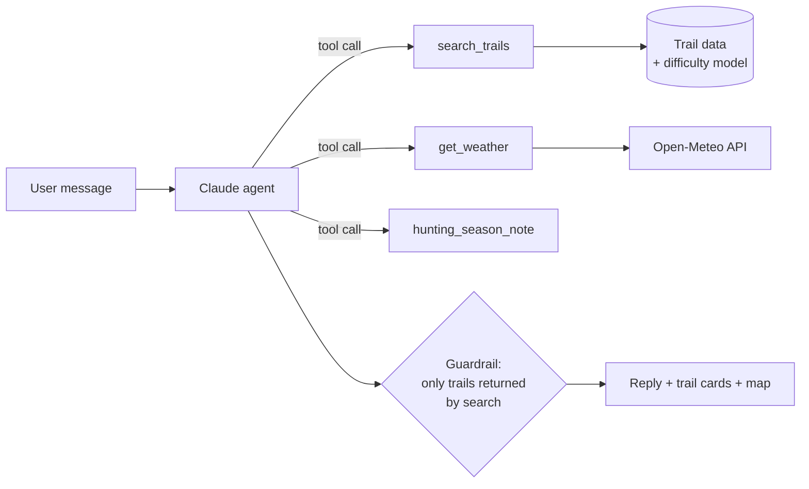

# HikingPSU 🥾

**An AI hiking guide for Penn State and State College, built around difficulty ratings you can trust.**

Tell it *"Saturday afternoon, two of us, no car, about 3 hours, we'd like a view"* and it suggests real trails around Happy Valley. Each suggestion comes with a five-level difficulty rating, the reasons behind that rating, a time estimate, and how to get there without a car.

<!-- Add a screenshot or GIF of the app here:  -->

---

## Why we built this

Central Pennsylvania has hundreds of miles of trails within half an hour of campus. Even so, many students never hike them. When we talked to members of a Penn State hiking club, three problems kept coming up:

- **Difficulty labels are hard to trust.** Mainstream apps use three levels, and users assign them by hand. A short climb up a rocky Pennsylvania ridge and a flat walk around a lake can both end up as "moderate". Experienced hikers told us five levels would be much friendlier to beginners.
- **Many students don't have a car.** Most trail guides assume you can drive to the trailhead.
- **Local knowledge is scattered.** Hunting season, rocky terrain, weak cell signal and parking are things locals know, and most apps don't tell you.

HikingPSU addresses all three, and it is scoped to one region so the information can actually be accurate.

## What it does

- **🗣️ Plan in plain English.** Describe your group, time, transport and mood. The agent turns that into a structured search.
- **📊 Five explainable difficulty levels.** Every level comes with a reason, for example *"L3 · 4 mi, 600 ft of climbing, bumped one level for rocky footing and stream crossings."*
- **🚌 Car-free first.** Each trail is tagged with bus, walking, biking or driving access. Say "no car" and only reachable trails are returned.
- **🌤️ Context-aware.** Checks the forecast and sunset time, and reminds you to wear blaze orange during hunting season on state-forest trails.
- **🗺️ Map view.** Every trail appears on the map, colored by difficulty. Recommended trails are highlighted.
- **🛡️ No made-up trails.** The AI can recommend only trails that come back from the database search. Anything else is removed before it reaches you.

## How it works



Each part has one job:

| Layer | Responsible for | Not responsible for |
|---|---|---|
| **LLM (Claude)** | Understanding the request, choosing which tools to call, explaining results | Knowing trails, judging difficulty |
| **Difficulty model** | Assigning a 1–5 level from measurable trail attributes | Language |
| **Trail data** | Facts: distance, climbing, terrain, access, coordinates | Ranking |
| **Guardrail** | Dropping any recommendation that wasn't returned by a search | — |

This split is deliberate. Hiking has real safety consequences. A fluent model that invents a trail, or calls a very hard ridge "easy", is worse than having no tool at all. Facts come from data and rules, and the model only handles language.

If the live AI is unavailable (no network, invalid key, model error), the backend falls back to offline keyword matching, so the app still responds.

## The difficulty model

```
effort  = distance (mi) + elevation gain (ft) / 500        ← "equivalent miles"

L1 Starter    effort < 3.0
L2 Easy       effort < 5.5
L3 Moderate   effort < 9.0
L4 Hard       effort < 14
L5 Very Hard  effort ≥ 14

+1 level  if terrain score ≥ 4   (rocky + 2·scramble + water crossings + navigation)
+1 level  if ≤ 2.5 mi with ≥ 600 ft of climbing and it would otherwise be L1
```

Central PA trails are known for rocky footing, and that is why terrain can push a trail up a level. All thresholds live in one `CALIBRATION` dict in `backend/app/difficulty.py`. `backend/scripts/calibrate.py` compares the model's levels with ratings from experienced local hikers and reports how often they agree.

Current ratings for the seed trails:

| Trail | mi | ft gain | Level | Why |
|---|---|---|---|---|
| Arboretum & Hartley Wood Loop | 1.2 | 60 | L1 Starter | 1.2 mi loop; 60 ft of climbing |
| Millbrook Marsh Boardwalk | 1.5 | 30 | L1 Starter | 1.5 mi loop; 30 ft of climbing |
| Walnut Springs & Thompson Woods | 2.5 | 200 | L1 Starter | 2.5 mi loop; 200 ft of climbing |
| Mount Nittany – Mike Lynch Overlook | 2.3 | 650 | L2 Easy | rocky in places; short but steep |
| Musser Gap Trail | 3.6 | 700 | L2 Easy | 3.6 mi out-and-back; 700 ft of climbing |
| Shingletown Gap – Lower Trail | 4.0 | 600 | L3 Moderate | bumped for rocky footing, stream crossings |
| Indian Steps – Tussey Mountain | 2.4 | 900 | L3 Moderate | bumped for rocky footing, hands-on sections |
| Mount Nittany – Full Loop | 5.5 | 1100 | L4 Hard | bumped for rocky footing, easy to lose the trail |
| Shingletown Gap – Ridge Loop | 7.5 | 1500 | L5 Very Hard | rocky, hands-on, navigation, stream crossings |

## Getting started

**Requirements:** Python 3.11+, Node 18+, and an [Anthropic API key](https://console.anthropic.com/). You can skip the key and run offline with `DEMO_MODE=1`.

```bash
git clone https://github.com/Zihan64/HikingPSU.git
cd HikingPSU
```

**Backend**

```bash
cd backend
python -m venv .venv && source .venv/bin/activate
pip install -r requirements.txt
cp .env.example .env          # add ANTHROPIC_API_KEY, or set DEMO_MODE=1
uvicorn app.main:app --reload # API docs at http://localhost:8000/docs
pytest                        # runs without a network connection or API key
```

**Frontend** (in a second terminal)

```bash
cd frontend
npm install
npm run dev                   # http://localhost:5173, proxies /api to :8000
```

### Configuration

| Variable | Default | Purpose |
|---|---|---|
| `ANTHROPIC_API_KEY` | — | Claude API key |
| `HIKINGPSU_MODEL` | see `agent.py` | Which Claude model the agent uses |
| `DEMO_MODE` | `0` | `1` = no API calls, offline keyword matching |

`backend/.env` is loaded automatically. Variables already set in the environment take priority.

## API

| Method | Path | Description |
|---|---|---|
| `GET` | `/health` | Liveness check and trail count |
| `GET` | `/trails?max_level=&car_free=&max_time_min=` | Filtered list of trails with difficulty |
| `GET` | `/trails/{id}` | One trail |
| `POST` | `/chat` | `{ messages: [{role, content}], profile: {has_car} }` → reply, recommended trails, tool log |

## Project structure

```
backend/
  app/
    agent.py        Claude tool-use loop, fallback, guardrail
    difficulty.py   Five-level difficulty model
    store.py        Trail data and search (with feature synonyms)
    tools.py        search_trails · get_weather · hunting_season_note
    models.py       Pydantic schemas
    main.py         FastAPI routes
  data/trails.json  Trail database
  scripts/          Calibration against hiker ratings
  tests/            Model, search, guardrail and agent tests (no network needed)
frontend/
  src/              React + Vite + Tailwind + Leaflet
```

## Contributing trail data

Add a trail to `backend/data/trails.json`. Each entry needs distance, elevation gain, terrain scores (rocky 0–3; scramble, water crossings and navigation 0–2 each), trailhead coordinates, and access options (bus, walk, bike, drive). Set `"verified": true` only after someone has hiked the trail or checked it against an official map.

## ⚠️ Safety and data disclaimer

HikingPSU is a **planning aid, not a navigation tool**. Trail data was compiled by hand from public sources and may be inaccurate or out of date. Entries marked `verified: false` have not been checked in the field. The hunting-season flag is a rough approximation of the Pennsylvania calendar. Always check official sources such as [PA DCNR](https://www.dcnr.pa.gov/) and the [PA Game Commission](https://www.pgc.pa.gov/), carry a map, tell someone your plans, and turn back if conditions are worse than expected.

## Roadmap

- [ ] Grow to 30+ trails, with every entry verified
- [ ] Calibrate difficulty thresholds against local hikers' ratings and publish the agreement rate
- [ ] Personalized difficulty that adapts to each hiker's pace
- [ ] Community trail-condition reports (downed trees, mud, closures)
- [ ] Live CATA bus times for car-free trips

## Team

<!-- Replace with names and links -->
Built at Penn State by **Zihan Zhao**, **Zikai Shen**, **[teammate]** and **[teammate]**.

## Acknowledgements
- [OpenStreetMap](https://www.openstreetmap.org/) contributors for map tiles
- [Open-Meteo](https://open-meteo.com/) for free weather data
- [Anthropic Claude](https://www.anthropic.com/) for the agent

<!-- ## License
Choose one before making the repo public, e.g. MIT. Without a license, others cannot legally reuse the code. -->
